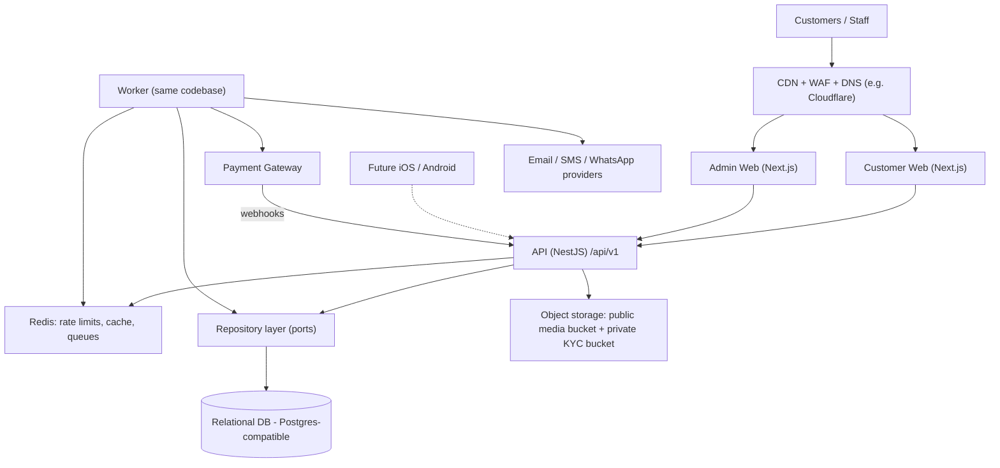
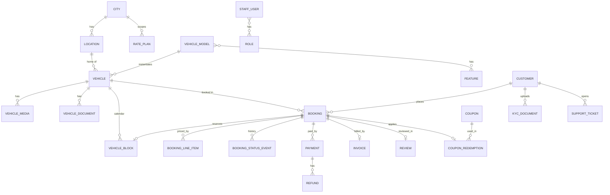
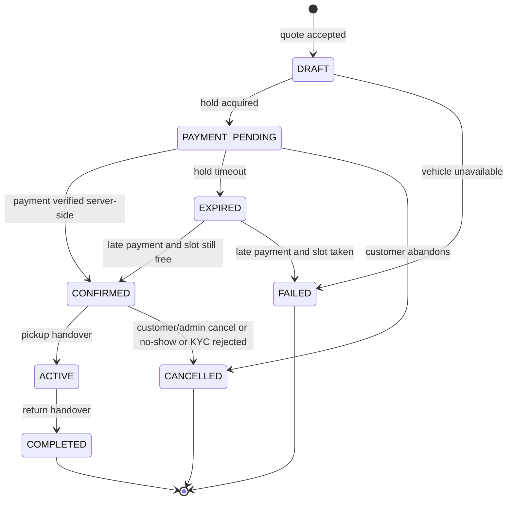
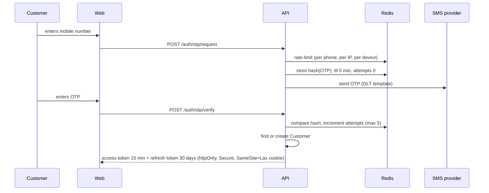
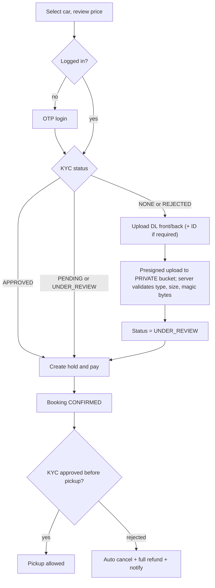

# Car Rental Platform — Pre-Implementation Design (PRD §73)

> Status: **DRAFT for review**. Nothing here is production code yet. Every section maps to an item in PRD §73.
> Working brand name: **Newlink** (from the existing `d:\NewLink` site). Please confirm (see §1).

## Contents
1. Ambiguities & decisions needed
2. System architecture
3. API architecture
4. Data model (provider-agnostic)
5. Booking state machine
6. Availability algorithm & double-booking prevention
7. Pricing calculation flow
8. Authentication & KYC flow
9. Admin permission model
10. Frontend route structure
11. Component architecture
12. Security risks
13. Scalability risks
14. MVP vs future
15. Edge-case handling matrix (PRD §60)
16. Proposed next steps

---

## 1. Ambiguities & Decisions Needed

Each item has a **proposed default** so work is not blocked. Items marked 🔴 materially change the design.

| # | Topic | Ambiguity | Proposed default |
|---|---|---|---|
| A1 🔴 | Existing site | `d:\NewLink` is a static "Newlink Tour & Tourism" site (gold theme, 30+ cities, chauffeur + airport services). PRD is self-drive only, Pune/Nashik. | New platform **replaces** it; same brand name, refreshed identity. Chauffeur/airport deferred. |
| A2 🔴 | Database | PostgreSQL, Supabase, Neon and AWS RDS (Postgres) are **all the same engine** – the open question is really *hosting*, not engine. | Commit to **Postgres-compatible SQL** as the engine; keep the **host** open. Repository layer still abstracts it. Double-booking safety needs a transactional DB with row locks (rules out most NoSQL). |
| A3 🔴 | Booking unit | Does a customer book a **specific car** (registration X) or a **model** ("any Creta")? | Book a **specific vehicle unit** (honest photos, per-car rating). Catalog metadata lives on `VehicleModel` so it is not duplicated. |
| A4 🔴 | Billing granularity | Hourly vs daily, minimum duration, partial days. | Hourly billing with **daily cap**; min 8 h, max 30 days, all configurable per city. |
| A5 🔴 | Security deposit | Example total ₹4,540 excludes the ₹5,000 deposit. Collected online, at pickup, or pre-authorised? | Collected **online with rental payment as a separate line**, refunded via gateway within N days after return. Card pre-auth deferred (gateway support is limited in India). |
| A6 🔴 | Tax calculation | PRD example taxes ₹540 on ₹4,500 *before* the ₹500 discount. Under GST, a discount shown on the invoice reduces the taxable value. | Tax on **post-discount** value. Self-drive rental is typically 18% GST (SAC 9973) – **confirm with your CA**; rate is config, not code. |
| A7 🔴 | KYC timing | PRD flow puts KYC before payment. Approval may take hours. | Customer must **upload** DL before payment; **approval** may still be pending. Pickup is blocked until APPROVED; rejection → automatic full refund. |
| A8 | Drop location | Search widget has only "Pickup"; data model has "Drop". | MVP = **round trip** (drop = pickup). Schema supports separate drop for future one-way. |
| A9 | Location vs city search | Show cars only at the selected location, or across the city? | Vehicle has one **home location**; search supports a specific location **or** "All locations in {city}". |
| A10 | Vehicle status | PRD statuses mix stored state (Maintenance, Inactive) with derived state (Booked, Active). | Store only **operational status** (`IN_SERVICE`, `MAINTENANCE`, `INACTIVE`). "Booked/Active" are **derived** from the calendar. |
| A11 | Booking vs refund states | `REFUND_PENDING/REFUNDED` in booking status conflicts with deposit refunds after `COMPLETED`. | Split into **booking status** + **payment status** (see §5). |
| A12 | Turnaround buffer | Cleaning/inspection time between rentals. | Configurable per city, default **2 h**. |
| A13 | Rental policies | Km limits, excess-km charges, fuel policy, late-return fee, min driver age, license age, damage liability – not defined. | Model them as a `RentalPolicy` entity per city/category; values from business. Late fee & excess-km **settled offline** in MVP. |
| A14 | Cancellation policy | Refund tiers not defined. | Configurable tiers, e.g. >24 h: 100% rental refund; 6–24 h: 50%; <6 h: 0%; deposit always 100%. |
| A15 | KYC verification | Manual vs automated (DigiLocker / DL-verification APIs). | **Manual admin review** in MVP behind a `KycVerifier` port; automated provider plugs in later. |
| A16 | Booking reference | `CAR-PN-10482` – brand prefix? sequential? | `NL-PN-7K3Q9M` (brand + city code + 6-char non-sequential). Never used as an auth secret. |
| A17 | Invoices | GST invoices need **consecutive numbering per financial year** and the business GSTIN. | Separate `Invoice` entity with gapless series per FY; generated on confirmation. |
| A18 | SMS/OTP | Indian SMS requires **DLT registration** (sender ID + templates). Lead time 1–2 weeks. | Start DLT registration now; provider behind `OtpSender` port (MSG91 / Gupshup / Twilio). WhatsApp OTP optional. |
| A19 | Staff accounts | Same identity table as customers? | **Separate** `StaffUser` identity with email + password + mandatory TOTP 2FA. Reduces privilege-escalation risk. |
| A20 | Styling | PRD recommends Tailwind + shadcn/ui. | Tailwind **v4** + shadcn/ui (Radix). Please confirm version. |
| A21 | Hosting | Not specified. | All services containerised and stateless; host chosen later (Vercel/Render/AWS/GCP all viable). |
| A22 | Pickup handover | Who moves CONFIRMED → ACTIVE → COMPLETED? Odometer/fuel/photos? | Staff app screen: handover checklist (odometer, fuel, photos) on pickup and return. |

---

## 2. System Architecture

### 2.1 Logical view



**Key principles**
- **API is the only owner of business rules.** Next.js apps never touch the DB; they call the API (server-side in Server Components, client-side only for interactive actions).
- **DB is the source of truth for locks.** Redis is used for caching, rate limiting and queues – never as the authority on availability.
- **Worker process** (BullMQ on Redis) runs: hold expiry sweeper, outbox publisher, notifications, webhook post-processing, refund retries, reminders.
- **Transactional outbox**: domain events (`BookingConfirmed`, …) are written in the same DB transaction as the state change, then published by the worker → no "booking confirmed but email lost".
- **Stateless API + web nodes** → horizontal scaling behind a load balancer.

### 2.2 Layering inside the API (hexagonal)

```
Controller (HTTP, validation, auth guard)
  └─ Application Service (use case: CreateHold, ConfirmPayment…)
       ├─ Domain (pure TS: pricing rules, state machine, overlap math)
       └─ Ports (interfaces)
            ├─ Repositories      → adapter: SQL (ORM)  | in-memory (tests)
            ├─ PaymentGateway    → adapter: Razorpay   | fake
            ├─ ObjectStorage     → adapter: S3/R2      | local disk
            ├─ OtpSender / Notifier → adapter: MSG91, SES… | console
            └─ KycVerifier       → adapter: manual     | DigiLocker (future)
```

Swapping DB host, payment gateway or SMS provider = new adapter, zero change to services.

### 2.3 Repository layout (monorepo: pnpm + Turborepo)

```
apps/
  web/        Next.js – customer site (SSR/SSG, SEO)
  admin/      Next.js – staff console (auth-gated, no SEO)
  api/        NestJS – REST API + worker entrypoint
packages/
  contracts/  Zod schemas → TS types + OpenAPI; shared by all apps & future mobile
  domain/     Pure functions: pricing math, state machine, interval math (no I/O)
  ui/         Design-system components (shadcn-based) + tokens
  config/     ESLint, Prettier, tsconfig (strict) presets
infra/        Dockerfiles, docker-compose (local Postgres + Redis + MinIO), CI
```

---

## 3. API Architecture

### 3.1 Conventions
- Base: `/api/v1`. Breaking changes → `/api/v2`, never silent.
- JSON, camelCase, ISO-8601 UTC timestamps, money as **integer paise** + `currency: "INR"`.
- Validation with Zod schemas from `packages/contracts`; OpenAPI generated from the same schemas; typed client generated for web/admin/mobile.
- Cursor pagination: `?limit=20&cursor=…` → `meta.nextCursor`.
- **Idempotency-Key** header required on: hold creation, payment initiation, cancellation, refunds.
- Optimistic concurrency on admin edits via `version` (`If-Match`).
- Correlation `X-Request-Id` on every request/log line.

**Response envelope**
```json
// success
{ "data": { ... }, "meta": { "requestId": "…", "nextCursor": null } }
// error
{ "error": { "code": "VEHICLE_UNAVAILABLE", "message": "This car was just booked for these dates.",
             "details": [], "requestId": "…" } }
```
Error codes are a stable enum (`VALIDATION_FAILED`, `UNAUTHENTICATED`, `FORBIDDEN`, `NOT_FOUND`, `CONFLICT`, `VEHICLE_UNAVAILABLE`, `HOLD_EXPIRED`, `INVALID_STATE_TRANSITION`, `COUPON_INVALID`, `KYC_REQUIRED`, `RATE_LIMITED`, `PAYMENT_VERIFICATION_FAILED`, `INTERNAL`).

### 3.2 Endpoint map (MVP)

**Public catalog (cacheable)**
| Method | Path | Notes |
|---|---|---|
| GET | `/cities` | active cities |
| GET | `/cities/{slug}/locations` | pickup locations, hours |
| GET | `/categories`, `/features` | |
| GET | `/vehicles/{id}` | metadata, media, rating (no availability) |
| GET | `/vehicles/{id}/reviews` | |

**Search & availability (never cached)**
| Method | Path | Notes |
|---|---|---|
| GET | `/search?city&location&start&end&filters&sort&cursor` | available vehicles + "from" price + **facets** built from available inventory |
| GET | `/vehicles/{id}/availability?start&end` | boolean + reason |
| POST | `/quotes` | full price breakdown for vehicle + period + coupon; returns `quoteId`, expiry |

**Auth**
| POST | `/auth/otp/request` · `/auth/otp/verify` · `/auth/refresh` · `/auth/logout` |
|---|---|
| POST | `/auth/google` (optional) · `/auth/email/*` (optional) |

**Customer (`/me`)**
| Method | Path |
|---|---|
| GET/PATCH | `/me` |
| GET/POST | `/me/kyc`, `/me/kyc/documents` (returns presigned **upload** URL), `/me/kyc/submit` |
| GET/POST/DELETE | `/me/saved-vehicles` |
| GET | `/me/bookings?status=`, `/me/bookings/{ref}` |
| GET | `/me/invoices/{id}` (short-lived signed download) |
| POST | `/me/reviews` |
| GET/POST | `/me/support/tickets`, `/me/support/tickets/{id}/messages` |

**Booking & payment**
| Method | Path | Notes |
|---|---|---|
| POST | `/bookings` | `{quoteId}` → creates booking + **10-min hold** (`PAYMENT_PENDING`). Idempotent. |
| POST | `/bookings/{ref}/payments` | creates gateway order for snapshot amount; returns checkout params |
| GET | `/bookings/{ref}/status` | polled by checkout/confirmation page |
| POST | `/bookings/{ref}/cancel` | returns refund preview first (`?dryRun=true`) |
| POST | `/webhooks/payments/{provider}` | signature-verified, deduped, the **only** path to `CONFIRMED` (plus server-side reconciliation) |

**Admin (`/admin/*`, staff auth + permission guard)**
`dashboard`, `vehicles` (+ `/media`, `/documents`, `/blocks`, `/status`), `vehicle-models`, `cities`, `locations`, `bookings` (+ `/cancel`, `/refund`, `/handover/pickup`, `/handover/return`, `/notes`), `customers` (+ `/suspend`, `/notes`), `kyc` (queue, approve, reject), `rate-plans`, `price-adjustments`, `holidays`, `coupons`, `payments`, `refunds`, `reviews` (moderate), `tickets`, `reports/*`, `staff`, `audit-logs`.

---

## 4. Data Model (Provider-Agnostic)

Conventions: UUIDv7 primary keys (sortable), `created_at/updated_at` UTC, soft delete via `status` (never hard-delete financial data), money in integer paise, `version` int for optimistic locking on admin-edited entities.

### 4.1 Entity overview



### 4.2 Entities and key fields

**Geography**
- `City`: id, name, slug, state, code (`PN`, `NS`), timezone (`Asia/Kolkata`), status, config JSON (buffer minutes, min/max duration, lead time, GST rate ref).
- `Location`: id, city_id, name, slug, address, lat, lng, contact phone, pickup_instructions, status, `LocationHours` (day_of_week, open, close), is_featured.
- `BlackoutPeriod`: scope (city | location), start_at, end_at, reason.

**Identity**
- `Customer`: id, phone (unique, E.164), email, name, dob, status (`ACTIVE`, `SUSPENDED`), kyc_status (denormalised), created_at.
- `AuthIdentity`: customer_id, provider (`PHONE`, `GOOGLE`, `EMAIL`), provider_subject.
- `RefreshToken`: id, subject_type, subject_id, token_hash, family_id, expires_at, revoked_at, device info.
- `StaffUser`: id, email, password_hash (argon2id), totp_secret (encrypted), status, city_scope[] (nullable = all).
- `Role`, `Permission`, `StaffRole`, `RolePermission`.

**KYC**
- `KycDocument`: id, customer_id, type (`DRIVING_LICENSE`, `GOV_ID`), side, storage_key (**private bucket**), document_number_encrypted, document_number_hash (dedupe), expiry_date, status (`PENDING`, `UNDER_REVIEW`, `APPROVED`, `REJECTED`), rejection_reason, reviewed_by, reviewed_at.

**Fleet**
- `VehicleModel`: id, brand, model, variant, category (`HATCHBACK`…`ELECTRIC`), fuel, transmission, seats, luggage, description, features[] (via join).
- `Feature`: id, key, label, icon.
- `Vehicle`: id, model_id, city_id, home_location_id, registration_number (unique), model_year, color, odometer_km, ops_status (`IN_SERVICE`, `MAINTENANCE`, `INACTIVE`), is_listed, rating_avg, rating_count, popularity_score, recommended_rank, version.
- `VehicleMedia`: id, vehicle_id (or model_id for shared stock images), storage_key, sort_order, alt, width, height, blur_placeholder.
- `VehicleDocument`: id, vehicle_id, type (`RC`, `INSURANCE`, `PUC`, `PERMIT`), storage_key (private), expires_on. (Expiring insurance can auto-block listing.)

**Calendar — the heart of availability**
- `VehicleBlock`: id, vehicle_id, type (`HOLD`, `BOOKING`, `MAINTENANCE`, `ADMIN_BLOCK`), start_at, end_at (**includes turnaround buffer**, half-open `[start, end)`), booking_id (nullable), is_active, hold_expires_at (nullable), created_by.
  - Postgres: `EXCLUDE USING gist (vehicle_id WITH =, tstzrange(start_at,end_at) WITH &&) WHERE (is_active)` – a DB-level guarantee that two active blocks never overlap.

**Pricing**
- `RatePlan`: id, scope (`VEHICLE` | `MODEL` | `CATEGORY`), scope_id, city_id, hourly_rate, weekday_daily_rate, weekend_daily_rate, security_deposit, min_hours, effective_from/to, version.
- `PriceAdjustment`: id, name, kind (`SEASON`, `HOLIDAY`, `PROMO`), scope (city/category/model/vehicle), start_date, end_date, mode (`MULTIPLIER` | `OVERRIDE_DAILY`), value, priority.
- `HolidayCalendar`: city_id, date, name.
- `TaxRule`: id, name, rate_bps (1800 = 18%), applies_to, effective_from.
- `Fee`: id, key (`DELIVERY`, `CONVENIENCE`), amount/percent, scope. (Mostly future.)
- `RentalPolicy`: city/category scope, km_limit_per_day, excess_km_rate, fuel_policy, late_fee_per_hour, min_driver_age, min_license_years, cancellation_tiers JSON.

**Booking**
- `Booking`: id, reference (unique), customer_id, vehicle_id, pickup_location_id, drop_location_id, start_at, end_at, status, payment_status, hold_expires_at, currency, subtotal, discount, tax, fees, rental_total, deposit_amount, amount_payable, coupon_id, **pricing_snapshot JSON** (rules used), **policy_snapshot JSON** (cancellation & rental policy at time of booking), kyc_status_at_booking, idempotency_key (unique per customer), source (`WEB`, `ADMIN`, `APP`), version.
- `BookingLineItem`: booking_id, kind (`RENTAL`, `DISCOUNT`, `TAX`, `FEE`, `DEPOSIT`), label, amount, metadata.
- `BookingStatusEvent`: booking_id, from, to, actor_type, actor_id, reason, at.
- `BookingNote` (internal), `Handover` (type pickup/return, odometer, fuel_level, photos keys, staff_id, at).

**Payments**
- `Payment`: id, booking_id, provider, provider_order_id, provider_payment_id, purpose (`RENTAL_AND_DEPOSIT`), amount, status (`CREATED`, `AUTHORIZED`, `CAPTURED`, `FAILED`), method, failure_reason, verified_at.
- `Refund`: id, payment_id, amount, reason (`CANCELLATION`, `DEPOSIT_RETURN`, `CONFLICT`, `KYC_REJECTED`), status (`PENDING`, `PROCESSING`, `SUCCEEDED`, `FAILED`), provider_refund_id, attempts, initiated_by.
- `WebhookEvent`: provider, event_id (**unique** → dedupe), type, payload, signature_valid, processed_at, error.
- `Invoice`: id, booking_id, number (gapless per FY series), issued_at, storage_key (PDF), totals.

**Commerce & engagement**
- `Coupon`: code (unique, case-insensitive), type (`PERCENT`, `FIXED`), value, max_discount, min_booking_amount, valid_from/to, total_usage_limit, per_customer_limit, city_ids[], category_ids[], vehicle_ids[], first_booking_only, status.
- `CouponRedemption`: coupon_id, customer_id, booking_id (unique), amount, status (`RESERVED`, `CONSUMED`, `RELEASED`).
- `Review`: booking_id (**unique**), customer_id, vehicle_id, rating 1–5, text, status (`PENDING`, `PUBLISHED`, `HIDDEN`).
- `SavedVehicle`: customer_id + vehicle_id (unique).
- `SupportTicket`: id, customer_id, booking_id (nullable, auto-attached), category, status, priority, assigned_to; `TicketMessage`.

**Platform**
- `OutboxEvent`: id, aggregate, type, payload, created_at, published_at.
- `NotificationLog`: channel, template, recipient, status, provider_message_id.
- `AuditLog`: actor_staff_id, action, entity_type, entity_id, before JSON, after JSON, ip, user_agent, at. **Append-only.**
- `AnalyticsEvent` (or ship to an external tool).

### 4.3 Critical indexes / constraints
- `vehicle_block`: exclusion constraint above; index `(vehicle_id, is_active, start_at)`; partial index on `hold_expires_at WHERE type='HOLD' AND is_active`.
- `vehicle`: `(city_id, home_location_id, ops_status, is_listed)`; `(model_id)`.
- `booking`: `reference` unique; `(customer_id, start_at desc)`; `(status, hold_expires_at)`; `(vehicle_id, start_at)`.
- `payment`: `provider_order_id` unique; `provider_payment_id` unique.
- `webhook_event`: `(provider, event_id)` unique.
- `review`: `booking_id` unique. `coupon_redemption`: `booking_id` unique.

> [!NOTE]
> If the final DB is not Postgres, the exclusion constraint is replaced by the portable algorithm in §6.3 (per-vehicle row lock + overlap check). The repository **contract** (`reserveIfAvailable` is atomic) stays identical, and a concurrency test suite verifies any adapter.

---

## 5. Booking State Machine

**Proposed split (A11):** `booking.status` = lifecycle, `booking.payment_status` = money. Keeps "Completed booking whose deposit refund is pending" representable.



Note: `DRAFT` is usually transient (same transaction as hold). It exists so we can record "attempted but unavailable" for analytics.

**Payment status (orthogonal)**
`UNPAID → PAID → (PARTIALLY_REFUNDED | REFUND_PENDING) → REFUNDED`; `REFUND_PENDING → REFUND_FAILED → REFUND_PENDING` (retry / manual).

**Transition rules table** (enforced in `packages/domain` + guarded `UPDATE … WHERE status = :expected`)

| From | To | Trigger | Actor | Side effects |
|---|---|---|---|---|
| DRAFT | PAYMENT_PENDING | `POST /bookings` | customer | create HOLD block (10 min), reserve coupon |
| PAYMENT_PENDING | CONFIRMED | verified webhook / reconciliation | system | HOLD→BOOKING block, consume coupon, invoice, outbox `BookingConfirmed` |
| PAYMENT_PENDING | EXPIRED | sweeper / lazy check | system | deactivate block, release coupon |
| EXPIRED | CONFIRMED | late verified payment, re-reserve succeeds | system | as CONFIRMED |
| EXPIRED | FAILED | late verified payment, re-reserve fails | system | auto full refund, apology notification |
| CONFIRMED | ACTIVE | pickup handover (requires KYC APPROVED, time window) | staff | record odometer/fuel/photos |
| CONFIRMED | CANCELLED | cancel | customer/staff | deactivate block, refund per policy snapshot |
| ACTIVE | COMPLETED | return handover | staff | deposit refund job, review invite |

Any other transition → `409 INVALID_STATE_TRANSITION`. Every transition writes a `BookingStatusEvent`.

---

## 6. Availability Algorithm & Double-Booking Prevention

### 6.1 Definitions
- Requested interval `R = [start, end)` (half-open, UTC).
- Effective blocking interval for a booking = `[start, end + bufferMinutes)`.
- Overlap test: `a.start < b.end AND b.start < a.end`.
- A block is **live** if `is_active AND (type <> 'HOLD' OR hold_expires_at > now())`.

### 6.2 Search (read path – fast, may use read replica)

```
1. Validate request
   - start >= now + city.leadTime            (e.g. 1 h)
   - minDuration <= end - start <= maxDuration
   - pickup & return times inside location hours (for that weekday)
   - R not inside a city/location BlackoutPeriod
2. Candidates = vehicles WHERE city = :city
                 AND (location = :loc OR :loc IS NULL)
                 AND ops_status = 'IN_SERVICE' AND is_listed
                 AND insurance/RC not expired
3. Remove candidates with ANY live block overlapping [start, end + buffer)
   (NOT EXISTS sub-query on vehicle_block – index-backed)
4. Apply filters (price, type, fuel, transmission, seats, brand, features)
5. Compute facets from step-3 set (only show filters relevant to inventory)
6. Batch-price via PricingService.quoteMany() → "from" price + total for period
7. Sort (recommended | price asc/desc | rating | popularity), cursor paginate
```
Search results are **advisory**. Only §6.3 is authoritative.

### 6.3 Reservation (write path – authoritative, primary DB)

```
reserveIfAvailable(vehicleId, start, end, bookingDraft):
  BEGIN TRANSACTION
    SELECT * FROM vehicle WHERE id = :vehicleId FOR UPDATE      -- serialises per vehicle
    assert ops_status = IN_SERVICE AND is_listed                 -- else VEHICLE_UNAVAILABLE
    UPDATE vehicle_block SET is_active = false                   -- lazy expiry of stale holds
      WHERE vehicle_id = :vehicleId AND type='HOLD' AND hold_expires_at <= now()
    IF EXISTS live block overlapping [start, end+buffer): ROLLBACK → 409 VEHICLE_UNAVAILABLE
    INSERT booking (status PAYMENT_PENDING, hold_expires_at = now()+10m, snapshot)
    INSERT vehicle_block (HOLD, [start, end+buffer), hold_expires_at)
        -- exclusion constraint = second safety net; violation → 409
    reserve coupon redemption (conditional on usage counters)
    INSERT outbox_event('HoldCreated')
  COMMIT
```

Why both lock **and** constraint: the row lock gives a clean, early error; the constraint guarantees correctness even if a future code path forgets the lock.

### 6.4 Hold expiry
- **Lazy**: every reserve call and every availability query treats expired holds as non-blocking (`hold_expires_at > now()`), so correctness never depends on the sweeper.
- **Sweeper** (every 30–60 s): transitions `PAYMENT_PENDING` bookings past expiry → `EXPIRED`, deactivates blocks, releases coupons, but **first** asks the gateway "was this order paid?" (handles lost webhooks).
- Hold length (10 min) is city config. Checkout UI shows a countdown from server `hold_expires_at`.

### 6.5 Maintenance & admin blocks
- Admin creates `MAINTENANCE` block for a period → same exclusion rule. If it overlaps live HOLD/BOOKING blocks the API returns the **conflict list**; admin must resolve (cancel with full refund + notify; vehicle swap is future).
- Setting `ops_status = MAINTENANCE/INACTIVE` immediately removes the car from search and rejects **new** holds; existing confirmed bookings are listed for the admin to action.

---

## 7. Pricing Calculation Flow

`PricingService.quote(request) → Quote` — pure domain function + repository lookups. Frontend only **displays** quotes.

```mermaid
flowchart LR
  A["Request: vehicle, city, start, end, coupon?"] --> B["Resolve RatePlan<br/>vehicle > model > category (city-scoped)"]
  B --> C["Split period into 24h segments + remainder"]
  C --> D["Per segment: day rate by precedence<br/>holiday > season > weekend > weekday"]
  D --> E["Remainder = min(hours x hourly, day rate)"]
  E --> F["Apply promo adjustments"]
  F --> G["Base rental (>= min billable hours)"]
  G --> H["+ Fees"]
  H --> I["Validate coupon, compute discount (cap)"]
  I --> J["Taxable = base + fees - discount"]
  J --> K["GST per TaxRule"]
  K --> L["Deposit (separate, refundable)"]
  L --> M["Quote: line items, totals, quoteId, expiresAt, rulesHash"]
```



**Worked example** (assumed: day rate ₹1,500, 3 days, coupon ₹500, GST 18%, deposit ₹5,000)

| Line | Amount |
|---|---|
| Rental (3 × ₹1,500) | ₹4,500 |
| Discount | −₹500 |
| Taxable value | ₹4,000 |
| GST 18% | ₹720 |
| **Rental total** | **₹4,720** |
| Refundable security deposit | ₹5,000 |
| **Pay now** | **₹9,720** (or ₹4,720 if deposit is collected at pickup – A5) |

**Rules**
- All arithmetic in integer paise; tax rounded half-up once per line; display rounds to rupees.
- Segment "day type" is determined by the **local date (city timezone)** of the segment start.
- Quote is persisted (or signed) with `quoteId` + 15-min expiry. `POST /bookings` re-computes and rejects if the price changed (`QUOTE_STALE`) — the customer always sees the final number before paying.
- Booking stores the full snapshot; later admin price changes never alter existing bookings.
- Coupon validation: active, date window, min amount, city/category/vehicle restriction, total and per-customer usage (checked atomically on reservation), first-booking flag.

---

## 8. Authentication & KYC Flow

### 8.1 Customer authentication (mobile OTP)


- Browsing, search and quotes require **no login**. Login is requested only at "Continue to book".
- Refresh-token **rotation** with reuse detection (reuse → revoke family).
- Mobile apps receive the same tokens in the body (secure storage) – same API.
- Profile completion (name, email) is a single short step after first login.

### 8.2 Staff authentication
Email + password (argon2id) + **mandatory TOTP**, short sessions (8 h), IP/device logged, separate cookie domain (`admin.` subdomain), lockout after failed attempts.

### 8.3 KYC in the booking flow


- Ordering trick: the **hold is created after** the upload step so the 10-min timer is not consumed by document upload.
- Documents served to admins only via short-lived (60 s) signed URLs, every view audit-logged.
- Document numbers encrypted at rest; hash stored for duplicate-account detection.
- Approval valid until DL expiry; re-KYC prompted when expired.

---

## 9. Admin Permission Model

RBAC with **permission strings** (`resource:action`) and optional **city scope** per staff user (future multi-city ops teams). Roles are data, not code.

| Permission area | Super Admin | Admin | Fleet Manager | Support | Finance* |
|---|:-:|:-:|:-:|:-:|:-:|
| Staff & roles | ✅ | – | – | – | – |
| Cities & locations | ✅ | ✅ | edit locations | view | – |
| Vehicles & media & docs | ✅ | ✅ | ✅ | view | – |
| Vehicle status / maintenance blocks | ✅ | ✅ | ✅ | – | – |
| Pricing & rate plans | ✅ | ✅ | – | – | view |
| Coupons | ✅ | ✅ | – | – | view |
| Bookings – view | ✅ | ✅ | ✅ (ops fields) | ✅ | ✅ |
| Bookings – handover / notes | ✅ | ✅ | ✅ | ✅ | – |
| Bookings – cancel | ✅ | ✅ | – | ✅ (policy-bound) | – |
| Refunds – initiate | ✅ | ✅ | – | request only | ✅ |
| Refunds – override policy amount | ✅ | – | – | – | ✅ |
| Customers – view basic | ✅ | ✅ | – | ✅ | ✅ |
| Customers – view KYC docs | ✅ | ✅ | – | – | – |
| KYC approve/reject | ✅ | ✅ | – | – | – |
| Customer suspend | ✅ | ✅ | – | – | – |
| Payments view | ✅ | ✅ | – | masked | ✅ |
| Reviews moderation | ✅ | ✅ | – | ✅ | – |
| Support tickets | ✅ | ✅ | – | ✅ | – |
| Reports | ✅ | ✅ | fleet only | – | ✅ |
| Audit logs | ✅ | view | – | – | – |

\* Finance is optional; can be merged into Admin for MVP.

Enforcement: NestJS guard checks `@RequirePermission('booking:cancel')` + city scope; PII fields are **serialised per role** (e.g. Support sees phone masked `98•••••210`). All mutating admin calls write `AuditLog` (before/after).

---

## 10. Frontend Route Structure

### 10.1 Customer app (`apps/web`)

| Route | Rendering | Notes |
|---|---|---|
| `/` | SSG + ISR | hero, search widget, sections per PRD §12 |
| `/cars?city&location&start&end&…` | SSR (dynamic) | URL is the search state; filters update URL via `router.replace` |
| `/cars/[vehicleSlug]-[id]` | ISR for metadata + client island for live availability/price | indexable |
| `/[city]/car-rental` | ISG | e.g. `/pune/car-rental` |
| `/[city]/[category]-rental` | ISG | only for city×category combos with ≥ N cars (avoid thin pages) |
| `/[city]/locations/[locationSlug]` | ISG | map, hours, instructions |
| `/checkout/[bookingRef]` | SSR, no-index | review → login → KYC → pay; countdown |
| `/booking/[bookingRef]/confirmation` | SSR, no-index | polls status until CONFIRMED |
| `/login` | client | OTP; supports `?next=` |
| `/account` | SSR, auth | overview |
| `/account/bookings`, `/account/bookings/[ref]` | SSR, auth | tabs: upcoming/active/completed/cancelled |
| `/account/profile`, `/account/documents`, `/account/saved`, `/account/payments`, `/account/support` | SSR, auth | |
| `/support`, `/faq`, `/how-it-works` | SSG | |
| `/legal/terms`, `/legal/privacy`, `/legal/cancellation-policy`, `/legal/rental-agreement` | SSG | |
| `sitemap.xml`, `robots.txt` | generated | |

### 10.2 Admin app (`apps/admin`, separate subdomain, `noindex`)
`/login`, `/` (dashboard), `/bookings`, `/bookings/[ref]`, `/calendar` (fleet timeline), `/vehicles`, `/vehicles/new`, `/vehicles/[id]` (tabs: details, media, documents, pricing, blocks, history), `/models`, `/locations`, `/cities`, `/customers`, `/customers/[id]`, `/kyc`, `/pricing` (rate plans, adjustments, holidays), `/coupons`, `/payments`, `/refunds`, `/reviews`, `/support`, `/reports`, `/staff`, `/audit`.

---

## 11. Component Architecture

### 11.1 Layers
```
packages/ui (design system, no business knowledge)
  tokens: color, type scale, spacing, radius, shadow, motion
  primitives: Button, Input, Select, Combobox, DateTimePicker, Sheet, Dialog,
              Tabs, Badge, Skeleton, Toast, Tooltip, Slider, Checkbox, EmptyState, ErrorState
apps/web/components (domain)
  search/   SearchWidget (desktop bar) · SearchStepper (mobile guided) · CityPicker · LocationPicker · DateRangeTimePicker
  results/  ResultsLayout · FilterPanel · FilterSheet (mobile) · SortMenu · VehicleCard · VehicleCardSkeleton · NoResults
  vehicle/  Gallery · SpecGrid · FeatureList · PriceBreakdown · PickupLocationCard · ReviewList · StickyBookBar (mobile)
  checkout/ CheckoutSteps · HoldCountdown · KycUploader · CouponField · PayButton · PaymentStatusPoller
  account/  BookingCard · BookingTimeline · InvoiceLink · KycStatusBadge · TicketThread
  marketing/ Hero · CategoryGrid · HowItWorks · WhyUs · LocationsGrid · Testimonials · Faq · FinalCta · Footer
lib/
  api-client (generated from contracts) · search-params (typed URL state) · format (₹, dates IST) · analytics
```

### 11.2 Server vs client split
- **Server Components** (default): pages, VehicleCard, SpecGrid, PriceBreakdown (rendered from API quote), marketing sections, account lists.
- **Client islands** only: SearchWidget/Stepper, FilterPanel/Sheet, Gallery swipe, HoldCountdown, KycUploader, PayButton (gateway SDK loaded **only** on checkout), PaymentStatusPoller, Toasts.
- No global client state library; URL params + server data + small local state. Forms: React Hook Form + Zod (same schemas as API).

### 11.3 Design system direction (original, not a competitor clone)
- Background off-white `#FAFAF7`, text near-black `#14161A`, neutrals warm grey.
- **One** brand accent (proposal: deep "Sahyadri" green `#0F5F4A` or the existing Newlink gold refined to `#B8862B` for trust/premium) – choose one (open question).
- Type: **Inter** (UI) + one display face for headings (e.g. *Manrope* / *Satoshi*); restrained scale.
- 8-pt spacing, radius 10–12 px, 1-px borders, shadow only on raised elements, motion ≤ 200 ms, `prefers-reduced-motion` respected.
- Real vehicle photography (consistent angle/background) – no AI-generated imagery on live pages.

---

## 12. Security Risks

| Risk | Mitigation |
|---|---|
| Double booking via race | Row lock + DB exclusion constraint + idempotency keys (§6.3) |
| Forged payment success from client | Only signature-verified webhooks / server-side order fetch can confirm; amount & order id matched to booking snapshot |
| Webhook replay / spoofing | HMAC signature check, `event_id` dedupe, timestamp tolerance, raw-body verification |
| Price tampering | Server recomputes price; client sends only `quoteId` |
| Coupon abuse / enumeration | Rate-limit validation, per-customer limits, atomic usage counters, codes not guessable |
| OTP bombing / SMS cost attacks | Per-phone, per-IP, per-device limits, exponential cooldown, CAPTCHA (Turnstile) after threshold, OTP hashed, 5 attempts max |
| Account takeover | Short access tokens, rotating refresh tokens with reuse detection, httpOnly Secure cookies, logout-all |
| IDOR on bookings/invoices/KYC | Every query scoped by `customer_id` from token; references are not authorization |
| KYC data leak | Private bucket, server-side encryption, signed URLs ≤ 60 s, encrypted doc numbers, access audit, retention policy (DPDP Act 2023) |
| Malicious uploads | Presigned uploads with size/type limits, magic-byte check, re-encode images, AV scan (async) |
| Staff privilege misuse | Least-privilege RBAC, TOTP, PII masking, append-only audit logs, city scoping |
| CSRF | SameSite cookies + CSRF token on cookie-auth mutations; CORS allow-list |
| XSS (reviews, tickets) | React escaping, no `dangerouslySetInnerHTML` for UGC, strict CSP |
| Secrets leakage | Env vars / secret manager, never in Git, secret scanning in CI, separate keys per environment |
| Bot scraping of inventory/prices | WAF rules, rate limits on `/search`, caching for catalog |
| Dependency vulnerabilities | Dependabot/Renovate, `pnpm audit` in CI, lockfile pinned |
| Compliance | DPDP consent & privacy notice, GST invoices, PCI scope avoided (hosted gateway checkout) |

---

## 13. Scalability Risks

| Risk | Impact | Mitigation |
|---|---|---|
| Availability query cost grows with fleet × blocks | slow search | index-backed `NOT EXISTS`, GiST index on ranges, read replica for search, pre-filter by city/location |
| Per-vehicle row lock contention on hot cars | checkout latency | lock held only ms; per-vehicle granularity so different cars never contend |
| Pricing N cars per search | CPU | batch quoting, cache rate plans & adjustments (invalidate on admin change), pure functions |
| Webhook bursts / gateway retries | duplicate work | dedupe table, enqueue then process in worker, idempotent handlers |
| Sweeper falling behind | stale holds | lazy expiry makes correctness independent of sweeper; sweeper batches with `SKIP LOCKED` |
| Cache inconsistency | wrong data shown | cache only catalog/static; availability never cached; tag-based revalidation (`revalidateTag`) on admin edits |
| Image weight on mobile | slow LCP | object storage + image CDN, AVIF/WebP, responsive `sizes`, blur placeholders, priority only for LCP image |
| Single region DB | outage = downtime | managed HA, PITR backups, tested restore; multi-region later |
| Monolithic API growth | team velocity | Nest modules with strict boundaries (bookings, fleet, pricing, payments, identity) → extractable services later |
| Reporting on OLTP DB | contention | pre-aggregated daily stats tables; analytics warehouse later |
| Multi-city / multi-timezone | wrong times | city timezone stored; all logic uses UTC + city tz for day boundaries |
| Third-party owner marketplace (future) | schema rewrite | add `fleet_owner_id` on Vehicle now (nullable, default = company) |

---

## 14. MVP vs Future

| Area | MVP | Future (architecture ready via) |
|---|---|---|
| Cities | Pune, Nashik (data) | more cities = rows + config |
| Search/listing/filters/sort | ✅ | recommendation rules engine |
| Vehicle details, reviews | ✅ | – |
| Booking + 10-min hold + no double booking | ✅ | extensions, vehicle swap |
| Round-trip pickup | ✅ | one-way, airport, doorstep delivery (`drop_location_id`, `Fee`) |
| Pricing: hourly/daily/weekend/season/holiday/city/vehicle | ✅ | dynamic/demand pricing (new adjustment source) |
| Coupons | ✅ | referral, loyalty (ledger entity) |
| OTP auth | ✅ | Google/email (AuthIdentity providers) |
| KYC manual review | ✅ | automated DL verification (KycVerifier adapter) |
| Payments: one gateway | ✅ | second gateway, deposit pre-auth |
| Notifications: email + SMS | ✅ | WhatsApp, push (Notifier adapters) |
| Customer dashboard, cancellation, invoices, tickets | ✅ | – |
| Admin: dashboard, vehicles, locations, bookings, customers, KYC, pricing, coupons, payments, basic reports, audit | ✅ | advanced analytics, forecasting |
| Staff handover checklist | ✅ (basic) | damage claims workflow |
| Fleet-owner marketplace, corporate accounts, subscriptions, native apps, AI assistant | ❌ | `fleet_owner_id`, org entity, versioned API |

---

## 15. Edge-Case Handling Matrix (PRD §60)

| # | Case | Handling |
|---|---|---|
| 1 | Two users book same car simultaneously | Per-vehicle lock + exclusion constraint; loser gets `VEHICLE_UNAVAILABLE` with "similar cars" suggestions |
| 2 | Payment succeeds, browser closed | Webhook confirms independently; confirmation SMS/email sent; booking visible on next login |
| 3 | Payment fails during hold | Booking stays `PAYMENT_PENDING`; customer may retry until hold expiry; then `EXPIRED` |
| 4 | Webhook arrives late | If hold active → confirm. If expired → try re-reserve: success → `CONFIRMED`; conflict → `FAILED` + auto refund + notify |
| 5 | Refresh checkout | Checkout page is server-rendered from booking ref; same hold & countdown; idempotency key prevents duplicate holds |
| 6 | Old booking URL | Page renders current state (expired/cancelled/confirmed) with next action; only the owner can view |
| 7 | Vehicle unavailable during checkout | Hold guarantees it once created; before hold creation → 409 + alternatives |
| 8 | Admin sets maintenance during checkout | New holds rejected; active holds/bookings surfaced as conflicts for admin to resolve (refund + notify) |
| 9 | Overlap with existing booking | Rejected by algorithm and DB constraint; buffer included |
| 10 | Cancel after payment | Policy snapshot computes refund; refund job via gateway; `payment_status` tracks it |
| 11 | Refund fails | Retries with backoff; after N → `REFUND_FAILED`, admin alert + manual queue |
| 12 | Network drops during payment | Confirmation page polls `/status`; sweeper reconciles with gateway before expiring |

---

## 16. Proposed Next Steps

1. You review this doc and answer the 🔴 items in §1 (at least A1–A7).
2. I update this doc to v1.0 and produce a short **Sprint 1 plan**: monorepo scaffold, CI (lint, typecheck, test, build), design tokens + core UI primitives, local docker-compose (Postgres + Redis + MinIO), contracts package, repository ports with in-memory adapters.
3. Early, isolated proof: **concurrency test harness** for `reserveIfAvailable` (100 parallel attempts → exactly 1 success) before any UI is built on top of it.
